# COA — Computer Organization & Architecture
### Complete Study Notes with Flowcharts (Unit 1 & Unit 2)

**Primary source:** M. Morris Mano, *Computer System Architecture* (3rd Edition)<br>
**Companion topics (Von Neumann, generations, MIPS/MFLOPS, Amdahl's law) added from standard architecture references.**

---

## Master Map — Where Every Topic Lives

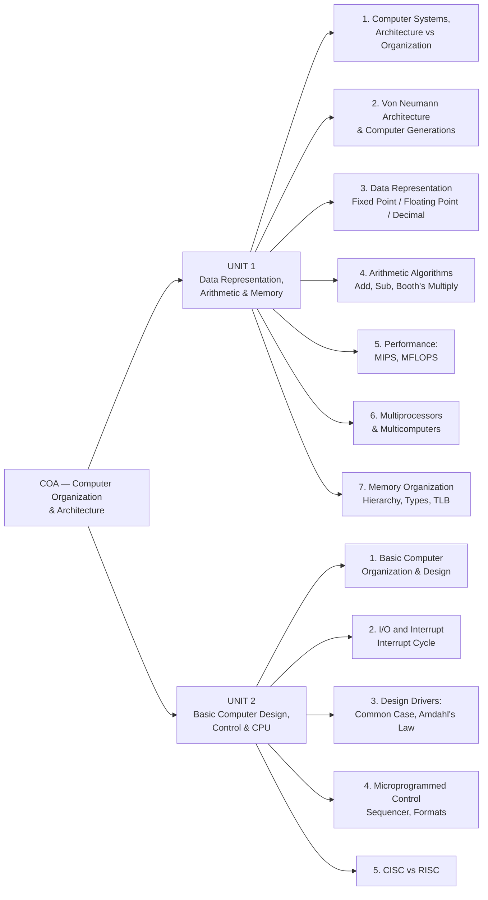

---
---

# UNIT 1

---

## 1. Introduction to Computer Systems, Organization and Architecture

### 1.1 Three Different Words (Very Common Exam Question)

| Term | What it deals with | Key question it answers |
|---|---|---|
| **Computer Architecture** | Structure and behaviour of the functional modules **as seen by the programmer** | *What* does the machine do? (instruction formats, addressing modes, instruction set, register set) |
| **Computer Organization** | *Way* hardware components are **connected together** | *How* is it built? (control signals, memory interface, timing, bus width) |
| **Computer Design** | Development of the hardware from a given set of **specifications** | *Design* the hardware to meet the spec |

> **Mano's definition (Preface):** *"Computer architecture is concerned with the structure and behavior of the various functional modules of the computer and how they interact to provide the processing needs of the user. Computer organization is concerned with the way the hardware components are connected together to form a computer system."*

**Same architecture, different organization:** IBM 360 family — same architecture, different organizations (from small to large).
**Same organization, different architecture:** microprogrammed control can implement different instruction sets on the same hardware.

### 1.2 The Five Functional Units of a Digital Computer

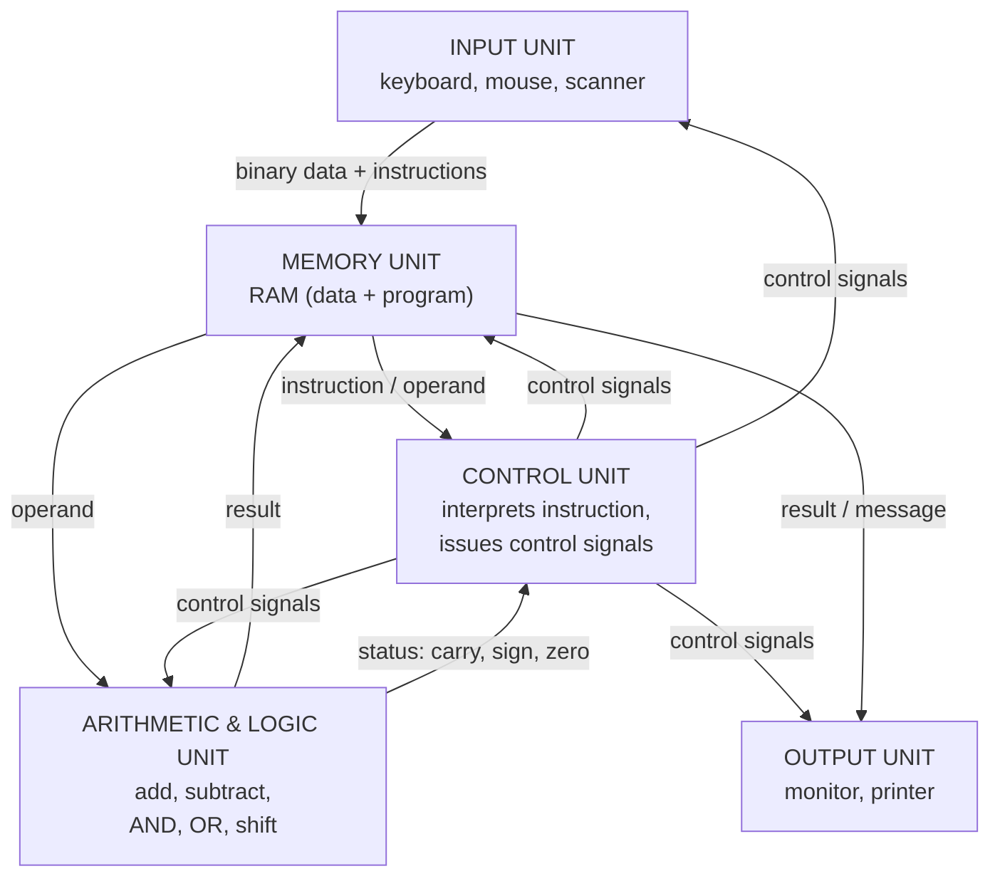

**Registers** (PC, IR, AC, MAR, MDR…) sit inside the processor and hold the *control information* and *data* currently being worked on.

### 1.3 Stored Program Concept

> *"The ability to store and execute instructions — the **stored program concept** — is the most important property of a general-purpose computer."* (Mano, Sec. 5-1)

Instructions and data are both stored in the **same memory** in binary. The control reads an instruction, decodes it, and issues a sequence of **microoperations**.

* **Macrooperation** = the operation part of an instruction (e.g. `ADD`).
* **Microoperation** = the smallest indivisible action (e.g. `AC ← AC + DR`), performed in one clock cycle.

---

## 2. Von Neumann Architecture

### 2.1 Features

1. **Single store** — instructions and data share one memory (no separate instruction memory).
2. **Program is stored as data** in memory, in binary.
3. **Store-and-execute** — instruction is fetched, then executed; a new instruction need not be fetched between steps.
4. **Sequential execution** — one instruction at a time, unless a branch occurs.
5. **Program counter (PC)** holds the address of the next instruction.
6. **Common bus** — a single shared path carries both instructions and data (this is why memory and I/O share a bus and a *fetch* and a *data* access cannot happen at the same instant).
7. **Control unit** sequenced by a **timing / clock** signal.
8. It describes the machine as a combination of: **CU + ALU + Registers + Memory + I/O**.

### 2.2 Von Neumann Machine — Block Flowchart

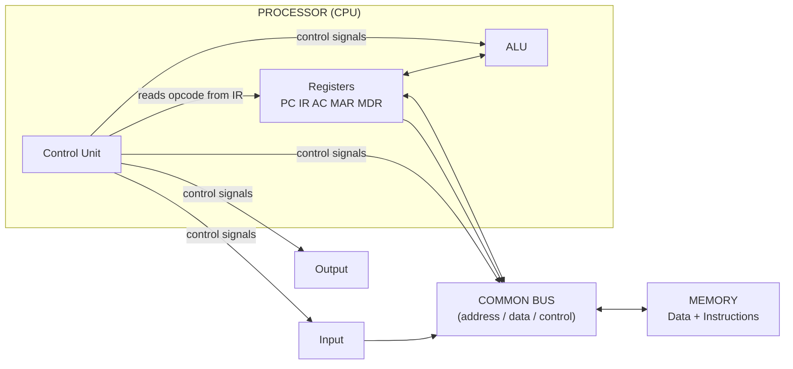

### 2.3 Fetch – Decode – Execute Cycle (The Heart of Von Neumann)

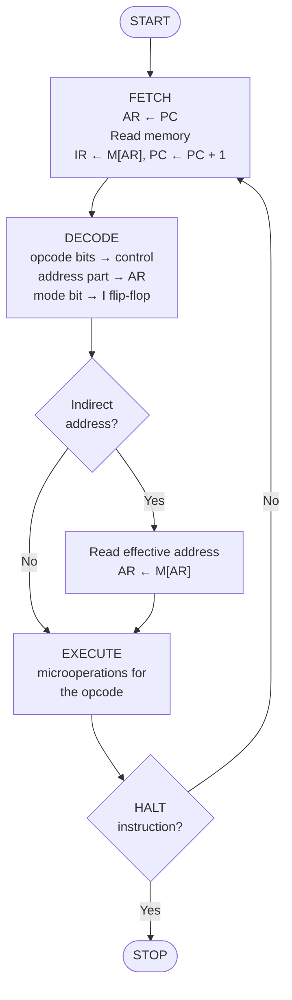

---

## 3. Evolution and Computer Generations

| Generation | Period | Main Device | Memory | Logic / Speed | Example |
|---|---|---|---|---|---|
| **1st** | 1946–1957 | Vacuum tubes / valves | Magnetic drum, mercury delay lines | Machine language, ~10⁴ ops/s, huge power & heat | ENIAC, EDVAC, UNIVAC, IAS machine |
| **2nd** | 1958–1964 | Transistors | Magnetic core memory | Assembly language, more reliable, cheaper, cooler | IBM 7090, IBM 1401 |
| **3rd** | 1965–1971 | SSI/MSI ICs (small & medium scale) | Core → semiconductor RAM | High-level languages (FORTRAN, COBOL), OS, multiprogramming | IBM 360, PDP-8 |
| **4th** | 1972–1990 | LSI / VLSI (thousands–millions of transistors) | Semiconductor RAM, cache, virtual memory | Microprocessors, personal computers, C, networks | Intel 8080/8086, Motorola 68000 |
| **5th** | 1991→ | ULSI / multi-core, GPUs, parallel processing | GB–TB main memory, SSD, distributed memory | Parallel processing, AI, expert systems, GUI | Modern multi-core PCs, supercomputers |

**Trend (Moore's Law):** transistor count roughly doubles every ~2 years → cost per bit falls, speed rises.

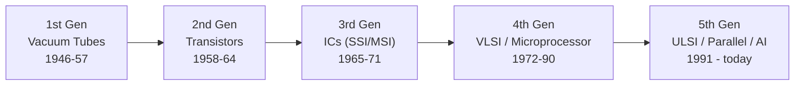

---
---

## 4. Data Representation

### 4.1 Number Systems & Conversion

A number in radix **r** = Σ (digit × rᵏ).

| System | Radix | Symbols |
|---|---|---|
| Decimal | 10 | 0–9 |
| Binary | 2 | 0, 1 |
| Octal | 8 | 0–7 |
| Hexadecimal | 16 | 0–9, A–F |

* 2³ = 8 → **1 octal digit = 3 binary bits**
* 2⁴ = 16 → **1 hex digit = 4 binary bits**
* Binary → octal: group bits in 3s (from binary point). Binary → hex: group in 4s.

**Conversion flowchart (Fig. 3-1):**

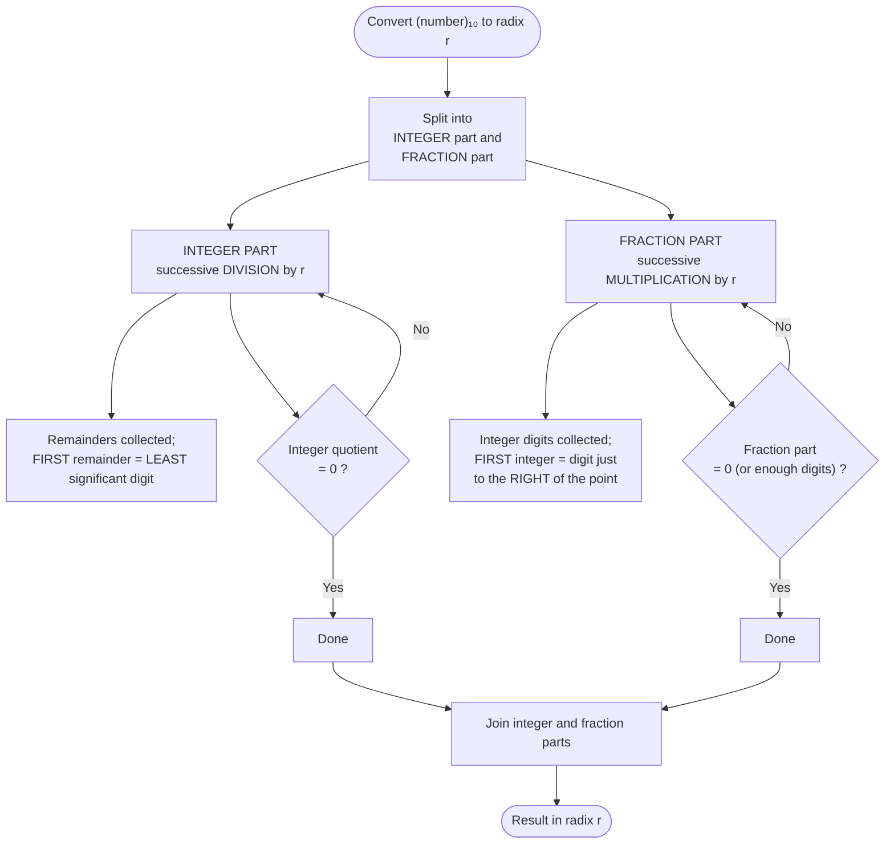

> **Example:** 41.6875₁₀ → 41 ÷ 2 repeatedly gives remainders 1,0,0,1,0,1 (LSB first) = 101001₂; 0.6875 × 2 repeatedly gives 1,0,1,1 = .1011₂. So **41.6875₁₀ = 101001.1011₂**.

### 4.2 Complements

| | **(r−1)'s complement** (diminished radix) | **r's complement** (radix) |
|---|---|---|
| Binary | 1's complement — invert every bit | 2's complement — 1's complement **+ 1** |
| Decimal | 9's complement — subtract each digit from 9 | 10's complement — 9's complement **+ 1** |
| Octal | 7's complement | 8's complement |
| Hex | F's complement | 10's complement (hex) |

* For an *n*-digit number N with radix r: **(r−1)'s comp of N = rⁿ − 1 − N**, **r's comp of N = rⁿ − N**.
* Special case: if N = 0, r's comp = 0 (no wrap-around).
* **Subtraction:** A − B = A + (r's comp of B), then **discard the end carry**. If carry occurs → result positive. If no carry → result is negative, take r's complement of the sum and attach a − sign.

### 4.3 Fixed-Point Representation

Fixed point = the binary point is placed at a **fixed** position (usually rightmost for integers, or after the sign for fractions).

**Three representations of negative numbers:**

| Decimal | Signed-Magnitude (8 bit) | 1's Complement | 2's Complement |
|---|---|---|---|
| +33 | `00100001` | `00100001` | `00100001` |
| −33 | `10100001` | `11011110` | `11011111` |
| +0 | `00000000` | `00000000` | `00000000` |
| −0 | `10000000` | `11111111` | **none** (0 only) |
| Range (n bits) | −(2ⁿ⁻¹−1) … +(2ⁿ⁻¹−1) | −(2ⁿ⁻¹−1) … +(2ⁿ⁻¹−1) | **−2ⁿ⁻¹ … +(2ⁿ⁻¹−1)** |

**Rules for signed 2's complement addition:**
1. Add the numbers **including** the sign bits.
2. A carry out of the sign-bit position is **discarded**.
3. **Overflow** occurs when the sum needs n+1 digits. Detect it by **XOR of the last two carries** (equivalently: overflow can only happen when adding two numbers of the **same** sign and getting a result of opposite sign).

**Rules for signed-magnitude:** signs handled separately — same sign ⇒ add magnitudes, result takes that sign; different sign ⇒ subtract smaller from larger, result takes the sign of the larger.

### 4.4 Floating-Point Representation

A floating-point number is written as

> **N = m × rᵉ**
>
> * **m = mantissa** — a signed *fixed-point* number
> * **e = exponent** — tells where the radix point is
> * **r = radix** (assumed, not stored)

*Example:* +6132.789 → mantissa `+0.6132789`, exponent `+04` → 0.6132789 × 10⁴.

**Normalized** = the most significant digit of the mantissa is **non-zero**. Normalization gives the **maximum precision** for a given number of bits.

* `00011010` is NOT normalized → shift left 3 times → `11010000`, and subtract 3 from the exponent (shifting left by 3 multiplies by 2³ = 8, so the exponent must decrease by 3 to keep the value).

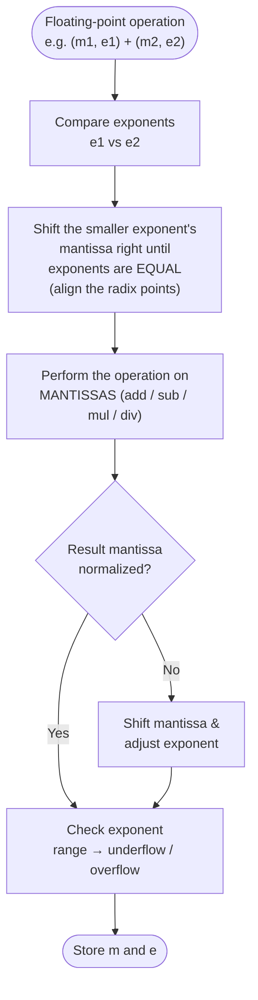

### 4.5 Decimal (BCD) Representation & Arithmetic

* Each decimal digit = 4 bits (8421 code). Sign digit: **`0000` (+)**, **`1001` (−)** i.e. 9 for minus.
* Prefer the **10's complement** system (9's complement then +1 to the least significant digit).
* Addition: add all digits **including the sign digit** and **discard the end carry**.
* Arithmetic with BCD is done by a **BCD adder** (see §6.7).

*Example:* (+375) + (−240) in signed 10's complement:
`0375 + 9760 = 0135` (end carry discarded) → **+135**.

### 4.6 Other Binary Codes

* **Gray code** — only **one bit changes** at a time between successive values (used in Karnaugh maps, shaft encoders, error minimisation).
* **ASCII** — 7 bits → 128 characters (letters, digits, punctuation, control).
* **Error detection codes** — **parity bit** (odd/even), **Hamming code** (single-error correction), **checksum**.

---
---

## 5. Digital Arithmetic Algorithms (with Flowcharts)

> **Algorithm** = a finite number of well-defined procedural steps.
> In a flowchart: **rectangles = computational steps**, **diamonds = decision steps**.

### 5.1 Addition & Subtraction — Signed-Magnitude (Fig. 10-2)

**Hardware:** registers A (magnitude) & Aₛ (sign), B & Bₛ; parallel adder; complementer (mode M) ; end-carry flip-flop **E**; add-overflow flip-flop **AVF**.
Subtraction/comparison is done as **A + 2's complement of B** (one adder + one complementer instead of two subtractors + comparator).

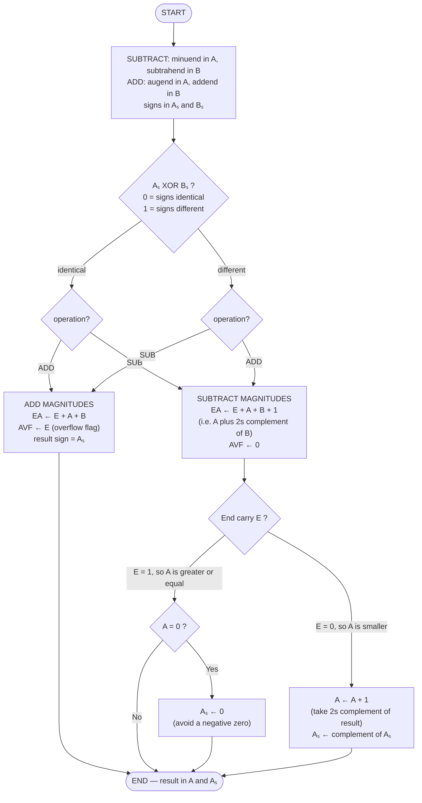

### 5.2 Addition & Subtraction — Signed 2's Complement (Fig. 10-4)

**Much simpler** — no sign comparison, no magnitude comparison.

**Hardware:** AC (accumulator) and BR, complementer + parallel adder, overflow flip-flop **V** (V = carryₙ₋₁ XOR carryₙ).

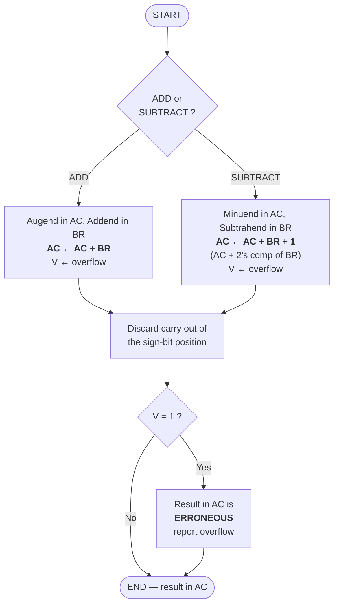

> **Why 2's complement is preferred:** it eliminates sign comparison, magnitude comparison and the negative-zero problem — *"most computers adopt this representation over the more familiar signed-magnitude."*

### 5.3 Multiplication — Signed-Magnitude (Fig. 10-6)

Paper-and-pencil method: look at each multiplier bit, LSB first; if 1 copy the multiplicand, if 0 copy zeros; shift left each line; add.

**Hardware registers:** B = multiplicand, Q = multiplier, A = partial product (cleared), E = extension, **SC = sequence counter** (loaded with n = number of multiplier bits).

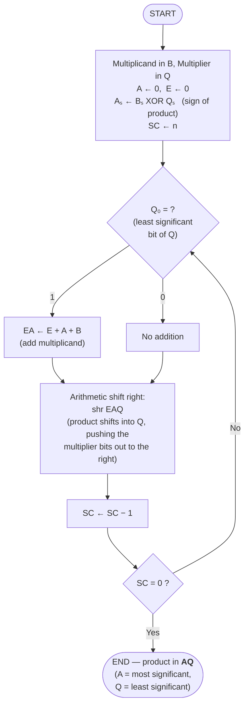

### 5.4 Booth's Multiplication Algorithm (Signed 2's Complement) — Fig. 10-8

**Idea:** a string of 1's from weight 2ᵏ to 2ᵐ equals **2ᵏ⁺¹ − 2ᵐ**.
So `001110` (+14) = 2⁴ − 2¹ = 16 − 2 = 14 → M × 14 = shift M left 4 times **minus** M shifted left once.

**Rules** (inspect two adjacent multiplier bits **Qₙ** and **Qₙ₊₁**, where Qₙ₊₁ is an extra appended flip-flop):

| Qₙ Qₙ₊₁ | Meaning | Action |
|---|---|---|
| **0 1** | first `0` after a string of `1`s | **AC ← AC + BR** (add multiplicand) |
| **1 0** | first `1` after a string of `0`s | **AC ← AC + BR + 1** (i.e. **subtract** BR) |
| **0 0** or **1 1** | same bit repeated | **No change** (only shift) |

* Works for **positive and negative** multipliers and multiplicands, because a negative multiplier ends with a string of 1's.
* **Overflow can never occur** — an addition and a subtraction always follow each other, so the two numbers being added always have **opposite signs**.

**Hardware:** AC, BR, QR (multiplier), extra flip-flop **Qₙ₊₁**, complementer + parallel adder, sequence counter SC.

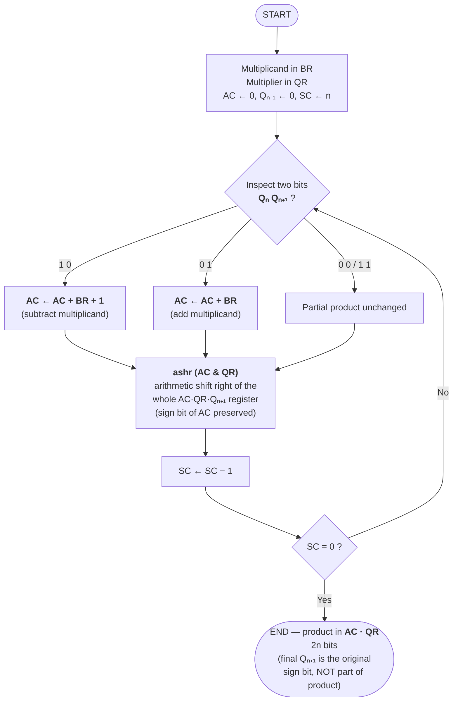

#### Worked Example: (−9) × (−13) = +117

BR = `10111` (−9), QR = `10011` (−13), n = 5.

| SC | Qₙ Qₙ₊₁ | Operation | AC | QR | Qₙ₊₁ |
|---|---|---|---|---|---|
| 101 | — | initial | `00000` | `10011` | 0 |
| 101 | **1 0** | AC ← AC − BR | `01001` | `10011` | 0 |
| | | ashr, SC ← 100 | `00100` | `11001` | 1 |
| 100 | **1 1** | no change | `00100` | `11001` | 1 |
| | | ashr, SC ← 011 | `00010` | `01100` | 1 |
| 011 | **0 1** | AC ← AC + BR | `11001` | `01100` | 1 |
| | | ashr, SC ← 010 | `11100` | `10110` | 0 |
| 010 | **0 0** | no change | `11100` | `10110` | 0 |
| | | ashr, SC ← 001 | `11110` | `01011` | 0 |
| 001 | **1 0** | AC ← AC − BR | `00111` | `01011` | 0 |
| | | ashr, SC ← 000 | `00011` | `10101` | 1 |

**Product = AC · QR = `00011 10101` = `0001110101₂` = +117 ✔**

### 5.5 Division (Signed Magnitude) — brief

* Similar to multiplication but **shift-and-subtract**: compare magnitudes, subtract if minuend ≥ subtrahend (quotient bit = 1), else shift (quotient bit = 0).
* **Divide overflow**: the most significant bit of the dividend = 1 → the quotient would not fit → error.
* Restoration / non-restoration methods also exist.

### 5.6 Floating-Point Arithmetic Operations

| Op | Steps |
|---|---|
| **Add / Sub** | 1. Compare exponents 2. Align (shift smaller mantissa right) 3. Add/subtract mantissas 4. Normalize 5. Check exponent range |
| **Multiply** | Add exponents, multiply mantissas, normalize |
| **Divide** | Subtract exponents, divide mantissas, normalize |

**Registers:** usually `E` (operand 1), `A` (operand 2), `B` (accumulator/quotient), `SC`.

### 5.7 Decimal Arithmetic (BCD)

**BCD Adder (Fig. 10-18):** add the two 4-bit digits; if the sum > 9 **or** a carry-out (Cout = 1) is produced, **add `0110` (6)** to the 4-bit sum and generate a carry to the next decimal position.

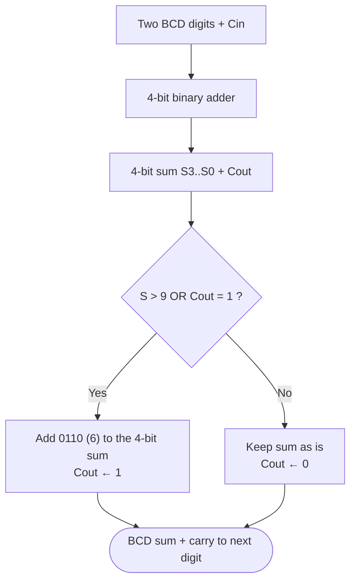

**BCD subtraction:** take the 10's complement of the subtrahend and add (discard end carry).

---
---

## 6. Performance — MIPS and MFLOPS

Let
* **IC** = instruction count, **CPI** = cycles per instruction, **τ** = clock cycle time, **f** = clock frequency (Hz).

Then **CPU execution time = IC × CPI × τ = (IC × CPI) / f**

| Metric | Formula | Meaning |
|---|---|---|
| **MIPS** (Million Instructions Per Second) | `MIPS = IC / (T × 10⁶) = f / (CPI × 10⁶)` | How many *machine instructions* per second |
| **MFLOPS** (Million FLOPS) | `MFLOPS = (number of FP operations) / (T × 10⁶)` | How many *floating-point* operations per second |
| **CPI** | `cycles / instruction` | Lower is better |
| **Throughput** | instructions or jobs completed per unit time | |

**Caution:** MIPS is misleading — a machine with a rich floating-point set may have a *lower* MIPS but be faster. A computer with a high MIPS rating may still be slow. **MFLOPS** is the better metric for scientific/numeric work; **benchmarks** are best of all.

```
Worked example:
  100 instructions, clock = 100 MHz, CPI = 2
  Execution time = 100 × 2 / 10⁸ = 2 × 10⁻⁶ s = 2 µs
  MIPS = 100 / (2 × 10⁻⁶ × 10⁶) = 100 / 2 = 50 MIPS
  Also: MIPS = f / (CPI × 10⁶) = 100×10⁶ / (2 × 10⁶) = 50 MIPS  ✔
```

---
---

## 7. Multiprocessors and Multicomputer

| | **Multiprocessor** | **Multicomputer** |
|---|---|---|
| Definition | Two or more **CPUs** sharing memory / I/O under **one OS** | Several **autonomous computers** connected by communication lines (a network) |
| Memory | Shared global memory (tightly coupled) **or** distributed local memory (loosely coupled) | Each node has its **own private memory** |
| Communication | Shared memory reads/writes | **Message passing** in packets (address + data + error code) |
| Control | One OS provides interaction among processors | Autonomous, may or may not communicate |
| Classification | **MIMD** (Multiple Instruction, Multiple Data stream) | — |

**Why use them**
1. **Improved performance** — (a) multiple independent jobs run in parallel, (b) one job is split into parallel tasks (compiler detects data dependencies).
2. **Improved reliability / graceful degradation** — if one processor fails, another takes over its functions.
3. Microprocessors + VLSI made it cheap to connect many CPUs.

**Tightly vs loosely coupled**

| Tightly coupled (shared memory) | Loosely coupled (distributed memory) |
|---|---|
| Common global memory all CPUs access | Each PE has private local memory |
| Usually a cache per CPU | Connected by a switching scheme |
| Can tolerate a **high degree of interaction** between tasks | Most efficient when interaction between tasks is **minimal** |

**Interconnection structures:**

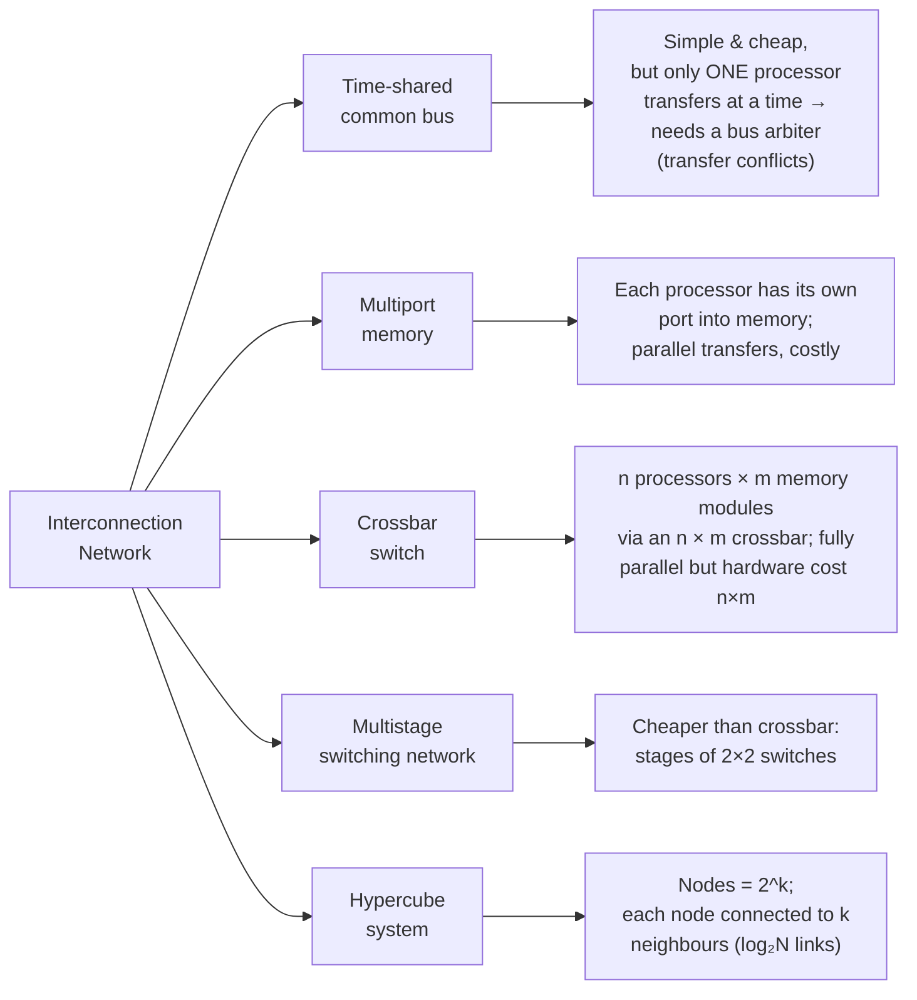

**Also relevant:** **cache coherence** problem (each CPU has its own cache of shared memory → inconsistent copies) and its solutions (snooping / directory-based protocols).

---
---

## 8. Memory Organization

### 8.1 Memory Hierarchy — Why?

* **Goal:** *"to obtain the highest-possible average access speed while minimizing the total cost of the entire memory system."*
* No single memory is simultaneously **large, fast and cheap**.
* **Economics:** as capacity ↑, cost per bit ↓ **but** access time ↑.
* **Locality of reference:** programs repeatedly use a small working set of locations (temporal + spatial locality) — so a small fast memory holding that working set gives most of the benefit.

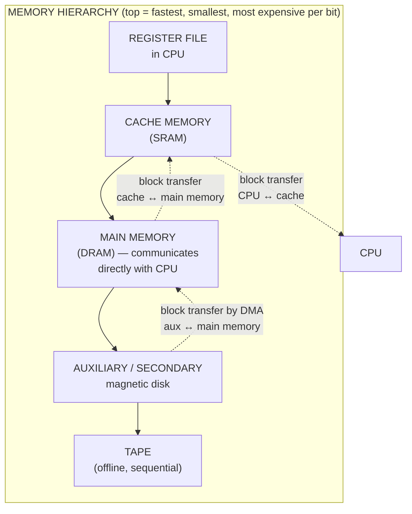

**Typical numbers (Mano, Sec. 12-1):**

| Level | Access time | Block size | Cost/bit | Speed vs. main memory |
|---|---|---|---|---|
| Cache | ~100 ns | 1–16 words | highest | ~**1 : 7** vs main memory (700 ns) |
| Main memory | ~700 ns | — | medium | baseline |
| Auxiliary (disk) | ~1000 × main memory | 256–2048 words | lowest | ~1000× slower |

**Multiprogramming:** two or more programs reside in different parts of the memory hierarchy at the same time, so the CPU is never idle waiting on I/O. The OS + **memory management system** supervises the flow of information between auxiliary and main memory.

### 8.2 Types of Memory (Classification)

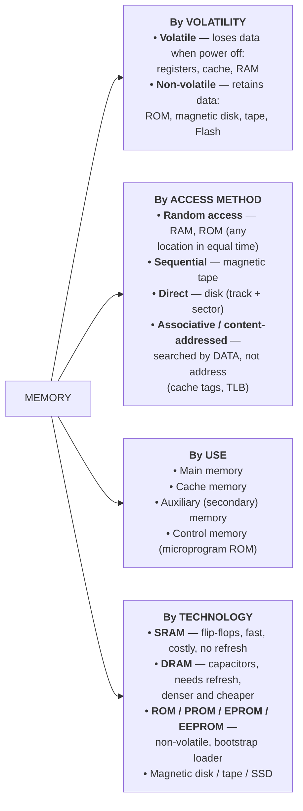

| | RAM | ROM |
|---|---|---|
| Read/Write | Both | **Read only** |
| Volatile | **Yes** | No |
| Contents | Programs & data that change | Bootstrap loader, constant tables, firmware |
| Sub-types | **SRAM** (flip-flops, no refresh, fast, costly) / **DRAM** (capacitors, needs refresh, dense, cheap) | PROM, EPROM, EEPROM, Flash, Mask ROM |
| Chip-select / bus | Bidirectional data bus, CS1=1 & CS2=0, RD/WR | Output-only data bus, CS only, no RD/WR |

**Associative memory (CAM):** addressed by *content*. The word searched for is applied to all comparison lines simultaneously → match found in one access. Used for **cache tags** and the **TLB**.

**Memory address map:** a table assigning address ranges to each RAM/ROM chip.

### 8.3 Cache Memory

Placed between CPU and main memory to **compensate for the speed differential** between fast CPU logic and slow main memory.

**Mapping techniques:**

| | Direct mapping | Set-associative mapping | Fully associative |
|---|---|---|---|
| Rule | block *i* of memory can go only into cache block *i* (mod n) | each cache word holds *k* tag+data items — a "set" | any block in any line |
| Address fields | **tag + index** | **tag + index(set)** | **tag + block offset** |
| Comparison | 1 tag | *k* tags simultaneously (associative search) | all tags |
| Hit ratio | lowest — conflict misses if two same-index/different-tag words alternate | improves as *k* grows | highest |
| Hardware | simplest | moderate | most complex & costly |
| Replacement | (not needed) | Random / FIFO / **LRU** | Random / FIFO / LRU |

**Write policy:**
* **Write-through** — update main memory on *every* write (cache updated in parallel). Main memory is always consistent → important for DMA. Simple, but more memory traffic.
* **Write-back** — update *only* the cache, mark the line dirty; copy to main memory only when the line is evicted. Fewer writes.

**Valid bit:** each cache word has a valid bit, cleared to 0 at initialization → forces misses until the cache fills with valid data.

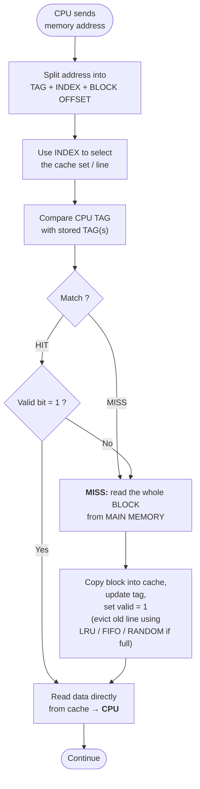

> **Hit ratio h** = (hits / total references). Average access time = h × t_cache + (1 − h) × t_main.

### 8.4 Virtual Memory

* Gives the programmer the **illusion** of a very large memory equal to the totality of auxiliary memory.
* CPU generates a **virtual (logical) address** → dynamically mapped to a **physical address** during execution.
* Programs are split into fixed-size **pages**; physical memory into **blocks** of the same size.
* **Page fault** = the referenced page is **not in main memory** → OS transfers it from auxiliary memory (possibly evicting a page using a replacement algorithm).

**Replacement algorithms:**
* **FIFO** — evict the page that has been in memory the longest (easy to implement, can thrash).
* **LRU** — evict the least recently used page (implemented with an **aging counter** per page; highest count = least recently used). Generally better.

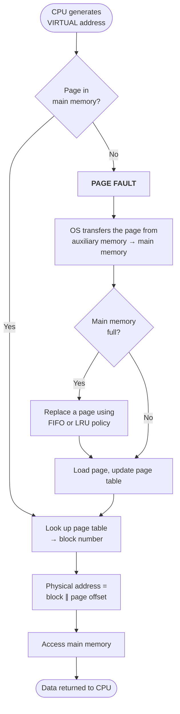

### 8.5 TLB — Translation Look-Aside Buffer

**Problem:** with **segmented-page** mapping, one memory reference from the CPU requires **three** memory accesses:
1. segment table,
2. page table,
3. the actual data.
That would slow the system down badly.

**Solution:** a small, very fast **associative memory (CAM)** holding the most recently used (segment, page) → block entries. This is the **TLB**.

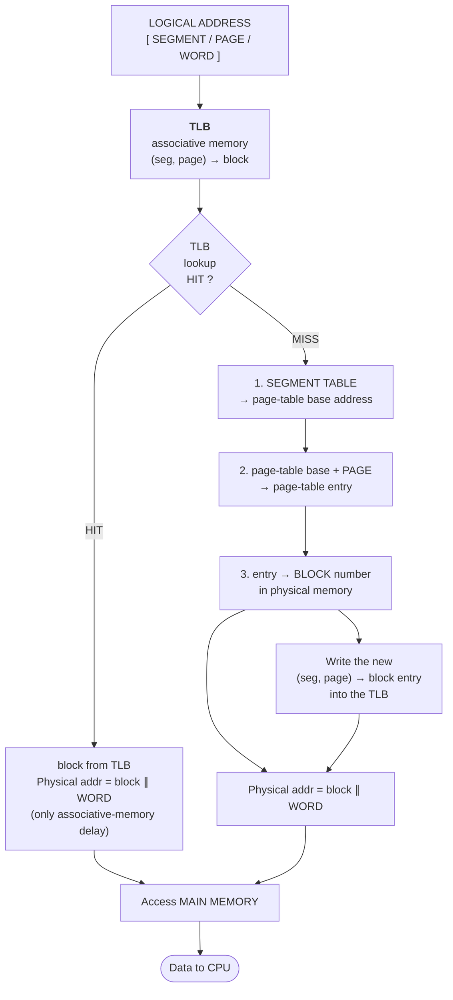

**Numerical example (Mano Fig. 12-22/12-24):**
* Logical address 20 bits = **4-bit segment** (16 segments) + **8-bit page** (256 pages) + **8-bit word** (256 words/page).
* Physical address 20 bits = **12-bit block** (4096 blocks) + **8-bit word**.
* Address `6027E` = segment 6, page 2, word 7E. Segment 6's page table base = 35 → entry 35+2 = **37** → block **019** → physical address **0197E**.

**Memory protection** uses a **descriptor** in the segment table: `base address | length | protection`. Access rights: read/write, read-only, execute-only, system-only. A reference outside the length → size-violation fault.

---
---

# UNIT 2

---

## 1. Basic Computer Organization and Design

**Hardware of the Basic Computer (Mano, Sec. 5-9):**
* Memory unit — **4096 words × 16 bits**
* **9 registers** — AR, PC, DR, AC, IR, TR, OUTR, INPR, SC
* **7 flip-flops** — I, S, E, R, IEN, FGI, FGO
* **2 decoders** — 3×8 operation decoder (D₀…D₇), 4×16 timing decoder (T₀…T₁₅)
* 16-bit **common bus**
* Control logic gates + adder/logic circuit feeding AC

### 1.1 General Register Organization / Computer Registers

| Symbol | Bits | Name | Function |
|---|---|---|---|
| **DR** | 16 | Data register | Holds memory operand |
| **AR** | 12 | Address register | Holds address for memory |
| **AC** | 16 | Accumulator | General-purpose processor register |
| **IR** | 16 | Instruction register | Holds instruction code |
| **PC** | 12 | Program counter | Holds address of **next** instruction |
| **TR** | 16 | Temporary register | Holds temporary data |
| **INPR** | 8 | Input register | Holds input character |
| **OUTR** | 8 | Output register | Holds output character |
| **SC** | 4 | Sequence counter | Generates timing signals T₀…T₁₅ |

**Flip-flops:** `E` (extended AC / end carry), `I` (indirect bit), `S` (start/stop), `R` (interrupt request), `IEN` (interrupt enable), `FGI` (input flag), `FGO` (output flag).

> PC is **auto-incremented** during fetch: `T₀: AR ← PC` then `T₁: IR ← M[AR], PC ← PC + 1`.

### 1.2 Common Bus System

Direct point-to-point wiring between every pair of registers would need an enormous number of wires → use a **single common bus**.

* Bus source selected by **S₂S₁S₀** (3 bits → 8 sources: DR=3, AR=0, PC=2, AC=4, IR=5, TR=6, INPR=?, Memory=7).
* The **destination** register is selected by enabling its **LD** (load) input; it captures the bus at the next clock transition.
* Registers have control inputs **LD, INR, CLR**.
* **Memory address always comes from AR** → no separate address bus is needed.
* Two microoperations can happen in the *same* clock cycle, e.g. `DR ← AC` **and** `AC ← DR`.

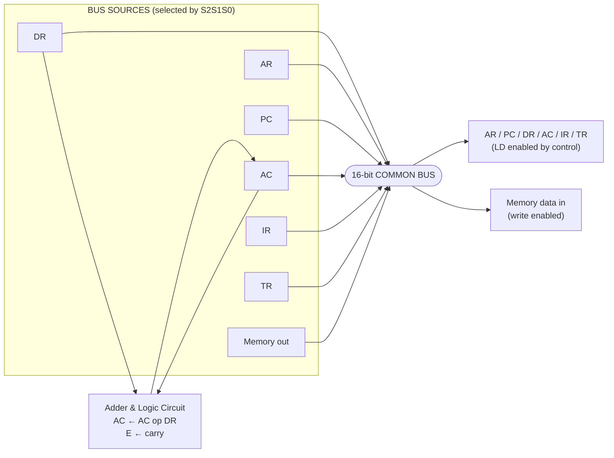

### 1.3 Computer Instructions — Formats

16-bit instruction word. Opcode in **bits 12–14**, mode bit **I** in **bit 15**, address in **bits 0–11**.

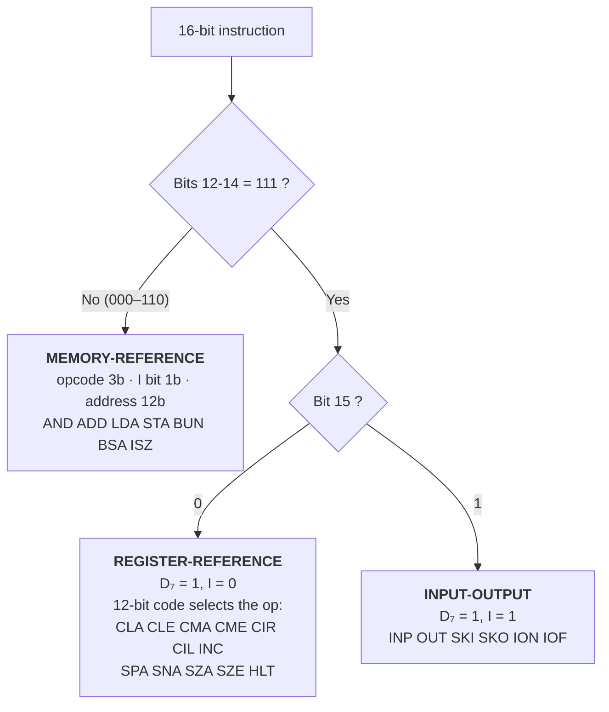

**Total = 25 instructions** (7 memory + 12 register + 6 I/O).

| Symbol | Hex (I=0 / I=1) | Description |
|---|---|---|
| AND | 0xxx / 8xxx | AC ← AC ∧ M[EA] |
| ADD | 1xxx / 9xxx | AC ← AC + M[EA], E ← Cout |
| LDA | 2xxx / Axxx | AC ← M[EA] |
| STA | 3xxx / Bxxx | M[EA] ← AC |
| BUN | 4xxx / Cxxx | PC ← EA (branch) |
| BSA | 5xxx / Dxxx | M[EA] ← PC, PC ← EA+1 (subroutine call) |
| ISZ | 6xxx / Exxx | M[EA] ← M[EA]+1, if =0 then PC ← PC+1 |
| CLA/CLE/CMA/CME/CIR/CIL/INC | 7800/7400/7200/7100/7080/7040/7020 | clear/complement/circulate/increment AC or E |
| SPA/SNA/SZA/SZE | 7010/7008/7004/7002 | skip next instruction on condition |
| HLT | 7001 | halt (clears start/stop flip-flop S) |
| INP/OUT | F800 / F400 | AC(0-7) ← INPR / OUTR ← AC(0-7) |
| SKI/SKO | F200 / F100 | skip on input/output flag |
| ION/IOF | F080 / F040 | IEN ← 1 / IEN ← 0 |

### 1.4 Timing and Control

```mermaid
flowchart LR
    IR["INSTRUCTION REGISTER<br/>bit15 → I flip-flop<br/>bits14-12 → decoder<br/>bits11-0 → control logic"] --> D["3 × 8 OPERATION DECODER<br/>D₀ … D₇"]
    IR --> CL["CONTROL LOGIC GATES"]
    SC["SEQUENCE COUNTER SC<br/>(4-bit, counts 0→15,<br/>CLR resets to 0)"] --> T["4 × 16 TIMING DECODER<br/>T₀ … T₁₅"]
    T --> CL
    D --> CL
    CL --> OUTS["CONTROL SIGNALS<br/>• bus selection S₂S₁S₀<br/>• register LD / INR / CLR<br/>• memory Read / Write<br/>• adder &amp; logic microops"]
```

* The control function is a **product of a decoded opcode and a timing signal**, e.g. `D₃T₄ : SC ← 0`.
* SC is incremented every positive clock edge unless cleared → sequence T₀, T₁, T₂, … ; clearing SC restarts at T₀.
* Memory cycle is assumed < clock cycle (otherwise **wait states** are needed).

**Two major control organizations:**
1. **Hardwired control** — logic gates, flip-flops, decoders. Fast, but changing the design means re-wiring.
2. **Microprogrammed control** — control signals stored in a **control memory (ROM)**. Changing the design = reprogramming, no rewiring.

### 1.5 Instruction Cycle Flowchart (Fig. 5-9 / 5-15)

**Phases:** (1) fetch (2) decode (3) read effective address if indirect (4) execute.

```mermaid
flowchart TD
    ST(["START"]) --> CLR["SC ← 0, IEN ← 0, R ← 0"]
    CLR --> FETCH{"<b>R ?</b>"}

    FETCH -->|"R = 0"| T0["<b>T₀</b> : AR ← PC"]
    FETCH -->|"R = 1"| IC["<b>INTERRUPT CYCLE</b>   (R = 1)<br/>T₀: AR ← 0, TR ← PC<br/>T₁: M[AR] ← TR, PC ← 0<br/>T₂: PC ← PC+1, IEN ← 0, R ← 0, SC ← 0"]
    IC --> T0

    T0 --> T1["<b>T₁</b> : IR ← M[AR], PC ← PC + 1"]
    T1 --> T2["<b>T₂</b> : Decode IR(12-14) → D₀…D₇<br/>AR ← IR(0-11),  I ← IR(15)"]
    T2 --> T3{"<b>T₃</b> : instruction type ?"}

    T3 -->|"D₇ = 1, I = 0"| REG["Execute REGISTER-REFERENCE<br/>at T₃ (control function r = D₇I′T₃)<br/>e.g. CLA, CMA, INC, SPA, HLT"]
    T3 -->|"D₇ = 1, I = 1"| IOP["Execute I/O instruction<br/>at T₃ (control function p = D₇IT₃)<br/>e.g. INP, OUT, ION, IOF"]
    T3 -->|"D₇ = 0, I = 1"| IND["<b>INDIRECT PHASE</b> — T₃: AR ← M[AR]"]
    T3 -->|"D₇ = 0, I = 0"| MEMR["Direct address already in AR<br/>→ continue at T₄"]

    IND --> MEMR
    MEMR --> EXEC["Execute MEMORY-REFERENCE<br/>instruction at T₄, T₅, T₆<br/>(AND, ADD, LDA, STA, BUN, BSA, ISZ)"]

    REG --> SETR
    IOP --> SETR
    EXEC --> SETR{"R = 1 ?"}
    SETR -->|"Yes"| IC
    SETR -->|"No"| T0
```

### 1.6 Execution of the 7 Memory-Reference Instructions (Fig. 5-11)

```mermaid
flowchart LR
    ROOT["MEMORY-REFERENCE<br/>instruction executed at T₄ / T₅ / T₆"] --> A
    ROOT --> B
    ROOT --> C
    ROOT --> D
    ROOT --> E
    ROOT --> F
    ROOT --> G

    A["<b>AND</b> (D₀)<br/>T₄: DR ← M[AR]<br/>T₅: AC ← AC ∧ DR, SC ← 0"]
    B["<b>ADD</b> (D₁)<br/>T₄: DR ← M[AR]<br/>T₅: AC ← AC + DR, E ← Cout, SC ← 0"]
    C["<b>LDA</b> (D₂)<br/>T₄: DR ← M[AR]<br/>T₅: AC ← DR, SC ← 0"]
    D["<b>STA</b> (D₃)<br/>T₄: M[AR] ← AC, SC ← 0"]
    E["<b>BUN</b> (D₄)<br/>T₄: PC ← AR, SC ← 0"]
    F["<b>BSA</b> (D₅) — subroutine CALL<br/>T₄: M[AR] ← PC, AR ← AR + 1<br/>T₅: PC ← AR, SC ← 0"]
    G["<b>ISZ</b> (D₆)<br/>T₄: DR ← M[AR]<br/>T₅: DR ← DR + 1<br/>T₆: M[AR] ← DR,<br/>if (DR = 0) then PC ← PC + 1,<br/>SC ← 0"]

    A --> H(["Next instruction"])
    B --> H
    C --> H
    D --> H
    E --> H
    F --> H
    G --> H
```

**BSA = subroutine call**, and an **indirect BUN with address 0** at the end of the subroutine = **return**.

---
---

## 2. Input, Output and Interrupt

### 2.1 I/O Configuration and Instructions

* `INPR` (8 bits) receives a character from the keyboard through a **transmitter interface**; `OUTR` (8 bits) sends to the printer through a **receiver interface**.
* **Flags synchronize the speed mismatch:**
  * `FGI` (input flag) — set to 1 when a new character is in INPR; cleared to 0 when the CPU accepts it.
  * `FGO` (output flag) — set to 1 when the output device is ready; cleared when the CPU loads OUTR.
* **I/O instructions:** `INP`, `OUT`, `SKI`, `SKO`, `ION`, `IOF` (control function `p = D₇IT₃`).

### 2.2 Programmed Control Transfer vs Interrupt

```mermaid
flowchart TD
    subgraph P["PROGRAMMED (polling)"]
        P1["Loop: test the flag"] --> P2{"Flag set ?"}
        P2 -->|"No"| P1
        P2 -->|"Yes"| P3["Do the transfer"]
    end
    subgraph I["INTERRUPT-DRIVEN"]
        I1["CPU runs the main program"] --> I2["Device raises interrupt<br/>when it is ready"]
        I2 --> I3["CPU finishes current instruction,<br/>saves return address"]
        I3 --> I4["Branches to I/O SERVICE ROUTINE"]
        I4 --> I5["Do the transfer"]
        I5 --> I6["Return to main program"]
    end
```

> **Why polling is wasteful:** at 1 µs per instruction cycle and a 10 char/s device (1 char per 100,000 µs), the CPU would check the flag **50,000 times** between transfers.

**Interrupt machinery:** `IEN` (interrupt enable flip-flop) set by `ION`, cleared by `IOF`. An interrupt flip-flop `R` is set when `IEN · (FGI + FGO) = 1`.

### 2.3 Interrupt Cycle Flowchart (Fig. 5-13 / 5-15)

The interrupt cycle is a **hardware implementation of "branch and save return address."**

```mermaid
flowchart TD
    ST(["Start of computer operation"]) --> ICY{"<b>Interrupt Cycle</b> entered<br/>because R = 1"}
    ICY --> S1["<b>T₀</b> : AR ← 0<br/>TR ← PC   (save return address)"]
    S1 --> S2["<b>T₁</b> : M[AR] ← TR<br/>i.e. <b>M[0] ← PC</b><br/>PC ← 0"]
    S2 --> S3["<b>T₂</b> : PC ← PC + 1  → PC = 1<br/>IEN ← 0,  R ← 0,  SC ← 0"]
    S3 --> FETCH["Next instruction cycle<br/>fetches the instruction at<br/>address <b>1</b>"]
    FETCH --> BUN["Address 1 holds <b>BUN 1120</b><br/>→ jumps to the I/O service routine<br/>at 1120"]
    BUN --> SERV["I/O service routine:<br/>• check FGI / FGO<br/>• transfer the character<br/>• execute ION to re-enable interrupts"]
    SERV --> RET["End of routine: <b>BUN 0</b> (indirect)<br/>→ indirect phase reads the return<br/>address stored at location 0"]
    RET --> BACK(["Resume the interrupted<br/>program"])
```

**Setting R:** `T₀'T₁'T₂'(IEN)(FGI + FGO) : R ← 1` — can happen at any time *except* during T₀, T₁, T₂.
**Fetch phase is modified** to `R'T₀, R'T₁, R'T₂` so that control goes either to the *instruction* cycle (R=0) or the *interrupt* cycle (R=1).

### 2.4 Priority Interrupt

A **priority interrupt** establishes which of several simultaneous requests is serviced first, and which requests may interrupt while another is being serviced.

* High-speed devices (disks) → **high** priority; slow devices (keyboards) → **low** priority.
* **Software polling:** one common branch address; the service program tests sources in sequence — order of testing = priority. *Disadvantage:* with many interrupts, polling time can exceed the available service time.
* **Hardware priority-interrupt unit:** decides in hardware, and gives each source its own **interrupt vector** → no polling.

```mermaid
flowchart LR
    subgraph DAISY["DAISY-CHAIN (SERIAL) PRIORITY"]
        CPU["CPU<br/>raises INTERRUPT ACKNOWLEDGE"]
        D1["Device 1<br/>(highest priority)<br/>PI → PO"]
        D2["Device 2<br/>PI → PO"]
        D3["Device 3<br/>PI → PO"]
        CPU -->|"acknowledge line"| D1
        D1 -->|"PO = 1 passes it on<br/>PO = 0 blocks it"| D2
        D2 --> D3
        D3 -.->|"VAD on data bus"| CPU
        D1 -.->|"VAD on data bus"| CPU
        D2 -.->|"VAD on data bus"| CPU
    end
```

| Property | Daisy chain (serial) | Parallel priority |
|---|---|---|
| Hardware | Simple wiring, one shared request line (wired-OR) | Interrupt register + mask register + priority encoder |
| Priority rule | **Nearest to the CPU wins** — first device with PI=1 and RF=1 puts PO=0 and drives its vector | Bit position in the interrupt register determines priority |
| Speed | Slower (signal propagates down the chain) | Faster — all decided in parallel |
| Masking | Hard | Mask register can disable individual sources in software |

**Rule:** a device with `PI = 1` and `PO = 0` is the highest-priority device currently requesting an interrupt; it places its **VAD** (vector address) on the data bus.

---
---

## 3. Design Drivers — Common Case and Amdahl's Law

### 3.1 "Make the Common Case Fast"

The most important quantitative **design principle**: since not all cases occur equally often, optimise the path that happens **most frequently**, even if it makes the rare cases slower.

**Classic example — the load/store path:**
* Most instructions are *register–register* and most memory references **hit in the cache** → build a fast single-cycle register path and a fast cache, and accept that a cache **miss** takes many cycles.
* Other examples: short instructions are more common than long ones (variable-length formats still let the common short case decode fast); simple addressing modes are more common than complex ones.

Other standard design drivers alongside it:
* **Simplicity favours regularity** (fixed instruction formats → easy to decode).
* **Good design demands good compromise** (e.g. memory capacity vs speed vs cost → hierarchy).
* **Quantify the benefit before you spend hardware** → Amdahl's Law.

### 3.2 Amdahl's Law

> **Speedup = 1 / [ (1 − F) + F / S ]**

where
* **F** = fraction of the total execution time that is *improved* (the enhanced part),
* **S** = speed-up factor applied to that part,
* **(1 − F)** = the fraction that is *not* improved (the "remainder").

**Limit:** as **S → ∞**, **Speedup → 1 / (1 − F)** — the improvement to the un-enhanced part puts a **hard ceiling** on the total gain.

**Corollary:** the greatest benefit comes from improving the part that consumes the **most time** — i.e. *"make the common case fast."*

```
Worked example:
  40% of the program can be sped up by 10×  →  F = 0.40, S = 10
  Speedup = 1 / [ (1 − 0.40) + 0.40/10 ]
          = 1 / [ 0.60 + 0.04 ]
          = 1 / 0.64
          = 1.5625   → only 1.56× faster

  Even with an infinitely fast accelerator (S → ∞):
  Speedupmax = 1 / (1 − 0.40) = 1 / 0.60 = 1.67×

  If instead you speed up the 60% part by 10×:
  Speedup = 1 / [0.40 + 0.60/10] = 1/0.46 = 2.17×   ← much better return
```

```mermaid
flowchart TD
    A["Identify the workload"] --> B["Measure time split:<br/>fraction F is the target,<br/>(1 − F) is the rest"]
    B --> C{"Speed up the target<br/>by factor S"}
    C --> D["New time = (1 − F) + F/S<br/>of the original"]
    D --> E["<b>Speedup = 1 / [(1 − F) + F/S]</b>"]
    E --> F{"Is F large ?"}
    F -->|"No — F small"| G["Little overall gain<br/>(Amdahl's ceiling 1/(1−F))<br/>→ spend effort elsewhere"]
    F -->|"Yes — F large"| H["Big gain —<br/><b>the common case was<br/>the right target</b>"]
```

---
---

## 4. Microprogrammed Control Organization

### 4.1 Terminology

| Term | Meaning |
|---|---|
| **Microoperation** | Smallest hardware action (e.g. `AC ← AC + DR`), one clock cycle |
| **Control word** | String of 1s and 0s giving the control variables at a given time |
| **Microinstruction** | One word of control memory — specifies **one or more** microoperations + next-address info |
| **Microprogram** | A **sequence** of microinstructions (= a routine) |
| **Control memory** | The memory (usually **ROM**) inside the control unit holding the microprogram |
| **Control address register (CAR)** | Holds the address of the current microinstruction |
| **Control data register / pipeline register** | Holds the microinstruction read from control memory while the next one is fetched (needs a **two-phase clock**) |
| **Microprogram sequencer** | The "next address generator" — decides the next CAR value |
| **Mapping** | Rule that transforms the machine instruction **opcode** into a control-memory address |
| **Dynamic microprogramming** | Microprogram loaded from disk into **writable** control memory (RAM) |

**Two memories:** **main memory** (user's programs & data, changes) and **control memory** (fixed microprogram, not visible to the user).

### 4.2 Organization of a Microprogrammed Control Unit (Fig. 7-1)

```mermaid
flowchart TD
    EXT["External input<br/>(status conditions)"] --> NAG["<b>NEXT ADDRESS<br/>GENERATOR</b><br/>= microprogram SEQUENCER"]
    AD["AD field of the<br/>microinstruction"] --> NAG
    NAG --> CAR["CONTROL ADDRESS<br/>REGISTER (CAR)"]
    CAR --> CM["<b>CONTROL MEMORY</b><br/>ROM, holds the microprogram"]
    CM -->|"<b>control word</b>"| CDR["CONTROL DATA REGISTER<br/>(pipeline register)"]
    CM -->|"next-address information"| NAG
    CDR --> MW["<b>Micro-operations</b><br/>in the data processor<br/>(registers, ALU, bus, memory)"]
    MW -.->|"status bits"| EXT
```

**Advantages of microprogrammed control**
* No re-wiring to change the design — just a different microprogram in control memory.
* Easy to implement a **complex instruction set**; each machine instruction = its own micro-routine that fetches, evaluates the effective address, executes, and returns to fetch.
* ROM is **cheaper and faster** than RAM and prevents the user from altering the architecture.
* **RISC** processors generally use **hardwired** control instead.

### 4.3 Address Sequencing (Fig. 7-2)

The control must be able to do **four things**:

1. **Increment** the control address register (sequencing within a routine).
2. **Unconditional or conditional branch** (conditioned on a status bit).
3. **Mapping** — transform the instruction opcode into a control-memory address.
4. **Subroutine call and return** (needs an external register **SBR** — ROM cannot be written).

```mermaid
flowchart TD
    AD["Branch address field<br/>of the microinstruction"] --> MUX["MULTIPLEXER<br/>(select source of next CAR value)"]
    INC["INCREMENTER<br/>CAR ← CAR + 1"] --> MUX
    MAP["MAPPING LOGIC<br/>external address from the<br/>instruction opcode"] --> MUX
    SBR["SUBROUTINE REGISTER<br/>(return address)"] --> MUX
    STAT["Status bits<br/>(carry, sign, zero, mode, I/O flags)<br/>selected by the CD field"] --> BRLOG["BRANCH LOGIC"]
    BRLOG -->|"test result T"| MUX
    MUX --> CAR["CONTROL ADDRESS REGISTER<br/>(CAR)"]
    CAR --> CM["CONTROL MEMORY"]
    CM --> OUT["<b>MICRO-OPERATIONS</b><br/>executed in the data processor"]
    CM -.->|"address field, status select,<br/>branch field"| AD
```

* **Conditional branch:** 3 bits select one of 8 status conditions; if the selected status bit = 1 → load the branch address, else → increment CAR.
* **Unconditional branch:** fix one status-bit input permanently at 1.
* **Mapping:** `CAR(2-5) ← DR(11-14)`, `CAR(0,1,6) ← 0` — the 4 opcode bits become the middle of the 7-bit control address.

### 4.4 Microinstruction Format (Fig. 7-4 — the example machine)

20-bit microinstruction in a **128-word × 20-bit** control memory:

| Field | Bits | Purpose |
|---|---|---|
| **F1** | 3 | Microoperation field 1 (AR/AC/PC operations) |
| **F2** | 3 | Microoperation field 2 (DR operations) |
| **F3** | 3 | Microoperation field 3 (misc. operations) |
| **CD** | 2 | Condition field — selects the status bit (`U`=always 1, `I`=DR(15), `S`=AC(15), `Z`=AC=0) |
| **BR** | 2 | Branch field — `00 JMP`, `01 CALL`, `10 RET`, `11 MAP` |
| **AD** | 7 | Address field (branch target / NEXT / empty) |

**Symbolic assembly line:** `LABEL: microoperations, CD, BR, AD`
`ORG` sets the origin. Example fetch routine:

```
        ORG 64
FETCH:  PCTAR            U   JMP  NEXT     ; AR ← PC
        READ, INCPC      U   JMP  NEXT     ; DR ← M[AR], PC ← PC + 1
        DRTAR            U   MAP           ; AR ← DR(0-10); CAR ← mapped opcode
```

**BR field functions:**

| BR | Symbol | Action |
|---|---|---|
| 00 | **JMP** | CAR ← AD if condition = 1, else CAR ← CAR + 1 |
| 01 | **CALL** | CAR ← AD, SBR ← CAR + 1, if condition = 1 |
| 10 | **RET** | CAR ← SBR (return from subroutine) |
| 11 | **MAP** | CAR(2-5) ← DR(11-14), CAR(0,1,6) ← 0 |

### 4.5 Horizontal vs Vertical Microprogramming

| Feature | **Horizontal microprogramming** | **Vertical microprogramming** |
|---|---|---|
| Microinstruction width | **Wide** — one bit (or a small field) per control signal | **Narrow** — fields are **encoded/decoded** |
| Coding | Unencoded (direct) | Encoded — k bits select 2ᵏ microoperations |
| Parallelism | **Many** microoperations can be started in **one** cycle | Few microoperations per cycle (mutually exclusive ones share a field) |
| Speed | **Fast** — control signals appear directly | **Slower** — signals must pass through decoders |
| Hardware | Longer control word → wider control memory, no external decoders | Shorter control word → needs **external decoders** (extra hardware & delay) |
| Control memory cost | Higher (wider words) | Lower (narrower words) |
| Difficulty to write | Easier to see what happens, but long words | Harder — need an assembler, careful about conflicts |
| Flexibility | Full | Limited by the encoding |
| Typical use | Hardwired-speed microprogrammed machines, **CISC** | Cost/space-oriented designs |

> In Mano's example the 9 bits of microoperation are split into **3 sub-fields of 3 bits each** → each is decoded by a **3 × 8 decoder**. This is the **vertical** style: reduces microinstruction size but adds decoder delay.

### 4.6 Design of the Control Unit — Microprogram Sequencer (Fig. 7-8)

```mermaid
flowchart TD
    ST["<b>CD field</b> selects a status bit<br/>carry · sign · zero · mode · I/O flags"] --> M2["MULTIPLEXER 2<br/>output <b>T</b> = test result"]
    BR["<b>BR field</b><br/>I₁ I₀"] --> IL["INPUT LOGIC<br/>inputs I₁, I₀, T<br/>outputs <b>S₁ S₀</b> (source select)<br/>and <b>L</b> (load enable)"]
    M2 --> IL
    SRC["FOUR SOURCES of the next CAR value<br/>1 · INCREMENTER — CAR + 1<br/>2 · AD field — branch address<br/>3 · SBR — return address<br/>4 · MAPPING LOGIC — instruction opcode"] --> M1["MULTIPLEXER 1<br/>selects one of the four sources"]
    IL -->|"<b>S₁ S₀</b>"| M1
    M1 --> CAR["CONTROL ADDRESS REGISTER (CAR)"]
    CAR --> CM["CONTROL MEMORY<br/>(ROM)"]
    CM --> MI["MICROINSTRUCTION<br/>→ micro-operations"]
```

**Input logic truth table / Boolean functions (Mano Table 7-4):**

| BR | I₁I₀ | T | S₁S₀ | L | Function |
|---|---|---|---|---|---|
| JMP | 00 | 0 | 00 | 0 | CAR ← CAR + 1 (increment) |
| JMP | 00 | 1 | 01 | 0 | CAR ← AD (jump) |
| CALL | 01 | 0 | 00 | 0 | increment |
| CALL | 01 | 1 | 01 | **1** | CAR ← AD, SBR ← CAR+1 (call) |
| RET | 10 | x | 10 | 0 | CAR ← SBR (return) |
| MAP | 11 | x | 11 | 0 | CAR ← mapped address |

> The **incrementer** is a combinational circuit made of cascaded half-adders (not a flip-flop counter) with a hard-wired `1` into the LSB stage.

---
---

## 5. Hardwired vs Microprogrammed Control

| Basis | **Hardwired Control** | **Microprogrammed Control** |
|---|---|---|
| Implementation | Gates, flip-flops, decoders, timing counter — actual **wiring** | Control signals stored as **microinstructions in control memory (ROM/RAM)** |
| Speed | **Fast** — can be optimised for speed | Slower — an extra ROM access per microinstruction |
| Modification | Must **re-wire / re-design** the logic | Just change the **microprogram** — no hardware change |
| Design complexity | Difficult for large instruction sets; circuit becomes very complex | Systematic and elegant; complexity moves into the microprogram |
| Cost | Cheaper for simple machines (no control memory) | Extra control memory cost |
| Flexibility | Fixed instruction set once built | Can even change the instruction set at run time (writable control memory / dynamic microprogramming) |
| Instruction set size | Practical only for **small** instruction sets | Naturally supports **large** instruction sets |
| Typical use | **RISC** processors, simple controllers (Chap. 5) | **CISC** machines, mainframes, floating-point units (Chap. 7) |
| Debugging | Hard — tracing signals in gates | Easy — read/trace the microprogram |

```mermaid
flowchart TD
    Q{"How should the control unit<br/>generate the sequence of<br/>microoperations ?"}
    Q -->|"Choice 1"| HW["<b>HARDWIRED</b><br/>IR opcode + timing signals T0..Tn<br/>→ combinational control logic gates<br/>→ control signals"]
    Q -->|"Choice 2"| MP["<b>MICROPROGRAMMED</b><br/>opcode → MAP → CAR →<br/>control memory ROM →<br/>microinstruction → control word<br/>→ control signals"]
    HW --> HWA["✔ Fast, low latency<br/>✔ Cheaper for few instructions<br/>✘ Fixed — must rewire to change<br/>✘ Logic becomes unmanageable<br/>for large instruction sets"]
    MP --> MPA["✔ Flexible — just reprogram<br/>✔ Systematic design<br/>✔ Supports complex instruction sets<br/>✘ Extra ROM delay per step<br/>✘ Slower than pure hardware"]
```

---
---

## 6. CISC vs RISC

| Feature | **CISC** (Complex Instruction Set Computer) | **RISC** (Reduced Instruction Set Computer) |
|---|---|---|
| Number of instructions | **Many** — typically 100 to 250 | **Few** — relatively small set |
| Addressing modes | **Many** — typically 5 to 20 | **Few** — mostly register; plus immediate and PC-relative |
| Instruction format | **Variable length** (2 to 5+ bytes) — needs byte-counting decode logic | **Fixed length**, word-aligned, **easy to decode** |
| Operand access | Instructions manipulate operands **directly in memory** (e.g. memory-to-memory ADD → 3 memory refs) | Memory access **only via LOAD and STORE**; everything else is register-to-register |
| Execution | Often several cycles, microprogrammed | **Single-cycle** instruction execution (via pipelining); load/store may take 2 cycles |
| Control unit | Usually **microprogrammed** | **Hardwired** |
| HLL support | One machine instruction per HLL statement (e.g. VAX, IBM 370) | Relies on the **compiler** to optimise |
| Registers | Fewer general registers | **Large** register file; **overlapped register windows** |
| Pipelining | Possible but harder | **Efficient instruction pipeline**, delayed load, delayed branch |
| Hardware | More complex decode/control logic; slow clock | Simple control → **fast clock** |
| Goal | Reduce the semantic gap between HLL and machine code; simplify compilation | **Reduce execution time** by simplifying the instruction set |
| Examples | VAX-11, IBM 370, Intel x86 (largely) | Berkeley RISC I/II, MIPS, SPARC, ARM |

**Overlapped register windows (Berkeley RISC I):**
* Each procedure call activates a **new window** of registers by incrementing a pointer; return decrements it.
* Adjacent windows **overlap** — the high registers of the caller are the low registers of the callee → parameters pass **with no data movement and no save/restore**.
* `window size = L + 2C + G`, `register file = (L + C) × W + G`
  where G = global registers, L = local registers/window, C = registers common to two windows, W = number of windows.
* **Example:** G = 10, L = 10, C = 6, W = 4 → window size = 10 + 12 + 10 = **32**; register file = (10+6)×4 + 10 = **74 registers**.
* **Berkeley RISC I:** 32-bit CPU, **31 instructions**, 3 addressing modes (register, immediate, PC-relative), **138 registers** = 10 global + 8 windows × 32.

```mermaid
flowchart TD
    IS["Instruction Set Design"] --> Q{"Which philosophy ?"}
    Q -->|"Maximise hardware help<br/>to the compiler"| CISC["<b>CISC</b><br/>many instructions, many modes,<br/>variable length, memory operands,<br/>microprogrammed control"]
    Q -->|"Maximise raw speed<br/>per clock"| RISC["<b>RISC</b><br/>few instructions, few modes,<br/>fixed length, load/store only,<br/>hardwired control + pipeline"]
    CISC --> CI["✔ Small semantic gap<br/>✔ Shorter programs<br/>✘ Complex, slow decode<br/>✘ Long critical paths"]
    RISC --> RI["✔ Fast decode &amp; fast clock<br/>✔ Simple hardwired control<br/>✔ Easy pipelining → 1 instr/cycle<br/>✘ Longer code (register spills)"]
```

---
---

# QUICK REVISION SHEET

### Must-know formulas
| | |
|---|---|
| CPU time | `IC × CPI × τ` |
| MIPS | `IC / (T × 10⁶) = f / (CPI × 10⁶)` |
| Amdahl's Law | `S = 1 / [(1 − F) + F/S]` ; max `= 1/(1−F)` |
| Cache avg access | `h·t_c + (1−h)·t_m` |
| Register file (windows) | `(L + C)W + G` |
| Window size | `L + 2C + G` |
| 2's complement | 1's complement + 1 |
| Booth pair `01` / `10` | add / subtract |

### Top 10 flowcharts to reproduce in the exam
1. Von Neumann block diagram
2. Fetch–Decode–Execute instruction cycle
3. **Basic-computer instruction cycle (Fig. 5-9 / 5-15)** with the R flip-flop branch
4. **Interrupt cycle (Fig. 5-13)**
5. Memory-reference instruction execution (Fig. 5-11)
6. **Booth's algorithm (Fig. 10-8)**
7. Signed-magnitude add/subtract (Fig. 10-2)
8. Signed 2's complement add/subtract (Fig. 10-4)
9. Memory hierarchy
10. **TLB / segmented-page address translation (Fig. 12-21)**

*(Bonus: cache hit/miss, virtual-memory page fault, microprogrammed control organization, address-sequencing of control memory.)*

### Fast facts
* Basic computer: **4096 × 16** memory, **25 instructions**, **8 registers + SC**, **3-bit opcode** (`111` = register/I/O).
* Register-reference recognized by **D₇ = 1, I = 0**; I/O by **D₇ = 1, I = 1**; memory-reference by **D₇ = 0**.
* `BSA` = call, `BUN 0` indirect = return.
* Booth: overflow **impossible**; 2's comp add/sub: overflow = **XOR of last two carries**.
* `IEN = 1` and `(FGI + FGO) = 1` → `R ← 1` → interrupt cycle.
* Daisy chain: the device closest to the CPU has highest priority.
* Cache↔main memory access-time ratio ≈ **1 : 7**; auxiliary ≈ **1000×** main memory.
* TLB converts 3 memory accesses → **1** associative search on a hit.
